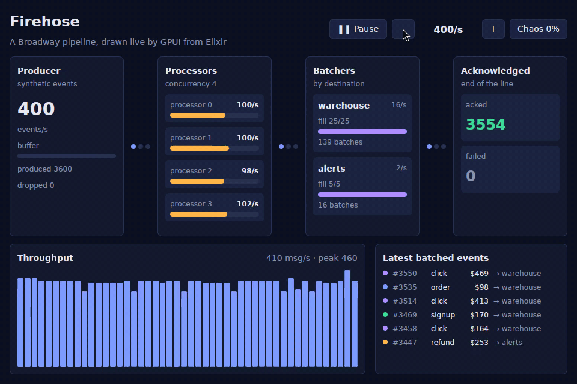

# Baguette

Native [GPUI](https://www.gpui.rs) applications written in Elixir, on macOS,
Windows, Linux, Android and iOS.

Elixir owns application state, views, styling and tests. GPUI is only the
renderer. Screens are plain `Baguette.View`s or real Phoenix LiveViews using
the same HEEx templates, function components and `phx-*` bindings, and a
`<webview>` can host a web LiveView inside a native layout. Apps write Rust
only for platform-specific NIFs.

> **Status:** proof of concept. Linux desktop works end to end; Android,
> LiveView and the other platforms are in progress.



## Examples

| | |
| --- | --- |
| [`examples/broadway`](examples/broadway) | A Broadway pipeline (producer, four processors, two batchers) drawn live: rates, load, batches, acks, failures and back-pressure. |
| [`examples/counter`](examples/counter) | The smallest app: a count held in a GenServer. |

Each one is a `mix release`:

```sh
cd examples/broadway
MIX_ENV=prod mix release
_build/prod/rel/firehose/bin/firehose_app
```

The host links `liberlang.a`; build it once with
`scripts/build-liberlang.sh OTP-29.1.2 ~/liberlang`, set
`BAGUETTE_LIBERLANG=~/liberlang` and put `~/liberlang/otp/bin` on `PATH`.

## A view

```elixir
defmodule Counter.View do
  use Baguette.View

  def mount(_args), do: {:ok, %{count: Counter.Store.get()}}

  def render(assigns) do
    ~H"""
    <div class="size-full flex-col items-center justify-center gap-6 bg-background">
      <text class="text-3xl font-bold">Count: {@count}</text>
      <button class="px-4 py-2 rounded-md bg-primary hover:opacity-90" phx-click="inc"
        aria-label="Increment">+</button>
    </div>
    """
  end

  def handle_event("inc", _values, assigns), do: {:noreply, %{assigns | count: Counter.Store.inc()}}
end
```

And its test, headless:

```elixir
test "increments" do
  Baguette.Test.click(0, "Increment")
  assert Baguette.Test.text(0) =~ "Count: 1"
end
```

## How it fits together

- `native/baguette_host`: the native host, built on
  [`tauri-plugin-gpui`](https://github.com/ziinc/tauri-gpui). It owns the main
  thread on every platform, which macOS, iOS and Android require. It links
  the BEAM (`liberlang.a`), boots the app's release with `erl_start`, and
  draws the trees the release sends.
- `native/baguette_nif`: the Rustler NIF that connects `Baguette.Host` to the
  host's C ABI (`native/baguette_abi`).
- `lib/`: the Elixir library: views, the render protocol, components, test
  helpers and `mix release` packaging.

GPUI is pinned to `gpui-pre =0.3.9`, the snapshot
[gpui-kit](https://crates.io/crates/gpui-kit) 0.7.3,
gpui-testing-library and gpui-visual-test use.

## Roadmap

1. Skeleton: Mix project, Rust host crate, Linux CI.
2. Embedded BEAM: the host boots a `mix release` and loads a static NIF.
3. Render layer: primitives, Tailwind-style classes, state variants.
4. Acceptance gate: a counter on Android whose state lives in a GenServer.
5. LiveView in a `<webview>` on desktop.
6. LiveView in a `<webview>` on Android.
7. Elixir starter components and a todo list.
8. ExUnit testing: render trees, headless interaction, screenshots.
9. Platform NIF extension point.
10. iOS, including the webview.
11. Hardening and a CI matrix for all five targets.

## Development

```sh
mix test
(cd native && cargo test)
scripts/e2e-linux.sh   # the counter release, clicked through AT-SPI on Xvfb
```

## License

MIT
